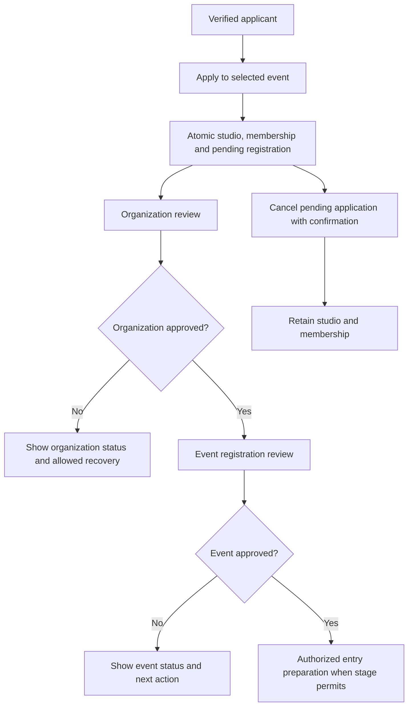

# F03 — Apply as a studio and track independent approvals

Target specification. Inherits [shared flow contract](../USER_FLOWS.md#shared-flow-contract-and-state-vocabulary),
[UI/recovery requirements](../UI_UX.md#shared-ui-state-and-recovery-contract) and
[evidence matrix](../USER_FLOWS.md#evidence-matrix-for-each-delivered-flow).
[Flow index](../USER_FLOWS.md) · [Delivery gates](../../DEVELOPMENT_PLAN.md).

- **Actor / prerequisites:** authenticated studio applicant; no representative
  role required. Target verified account and onboarding context; event accepts
  applications. Existing-studio reuse waits for ADR-001 migration.
- **Entry / screens:** S02 Apply → S08 application → S07 status; S06 admin review.
- **Happy path:** read requirements → complete minimal studio/contact details →
  submit once → server atomically creates studio, pending event registration and
  non-admin active membership → display two independent statuses → organizer
  verifies organization → organizer decides event application → applicant receives
  notification and sees next action after authoritative refresh.
- **Validation / permissions:** admin-created contact is not account membership.
  Backend binds creator identity; non-admin only own memberships. Event approval
  requires active approved organization; approval assigns appropriate representative
  access but does not bypass later stage/ownership checks. Pending profile reads
  are allowed, profile writes currently need studio.manage and stage permission.
- **Alternate / failure:** duplicate globally active studio name → safe conflict
  and contact/review, no automatic merge; pending/rejected organization blocks event
  approval; stage change rejects new application without discarding visible input.
  Reason/correction/resubmission policies are open, not invented statuses.
- **Loading / empty:** application form awaits event; no owned application offers
  eligible start; decision queue empty says no pending work; notification failure
  after a saved decision is separate from failed approval.
- **Cancel / recovery:** confirm pending-only cancellation and retain studio/member;
  approved/LOCKED registrations offer policy/contact, not unsupported cancellation.
  Lost create response checks owned studios/registrations before resubmission.
- **Result / stages:** independent organization/event PENDING → APPROVED/REJECTED
  per supported transitions. Current cancellation deletes pending registration,
  retaining studio/member; do not claim a stored CANCELED status. Non-admin create
  in PRE_REGISTRATION/REGISTRATION_OPEN, no new applications in DATA_REVIEW.
- **Dependencies:** canonical registration POST/GET/PATCH/DELETE, studio GET and
  approval PATCH; P2 security/email/audit, P3-REGISTRATION, P4-CORE/REVIEW,
  P5-APPLICATION. Pending correction/reason/deadline contracts still needed.
- **Acceptance:** roleless user resumes status; approvals remain distinct; decision
  belongs to exact event/studio; duplicate clicks, uncertain creation, wrong-event,
  inactive membership, concurrent decisions and notification retry are covered.

The following diagram separates independent decisions; it is not a new enum.

